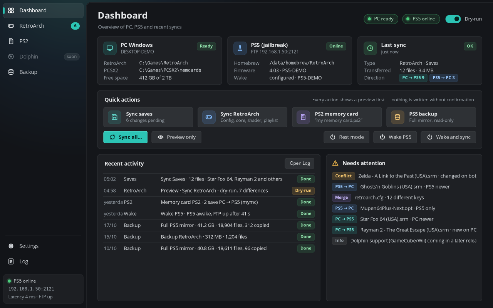
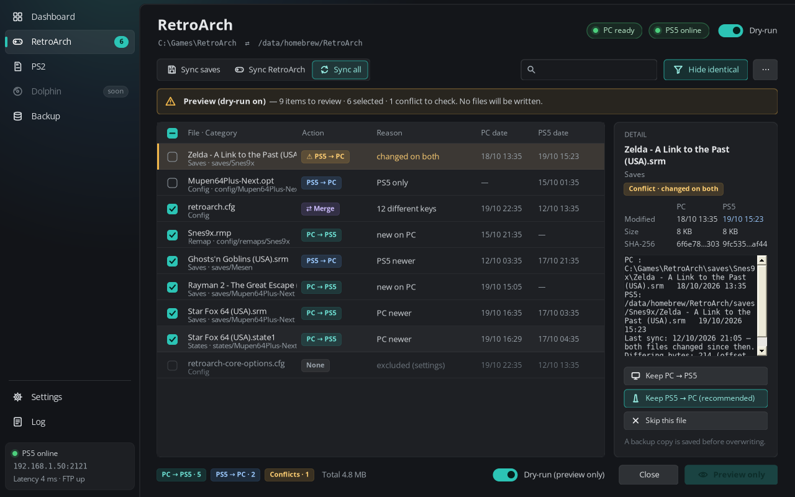
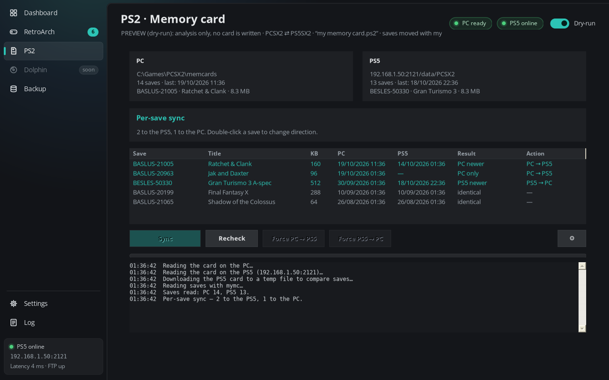
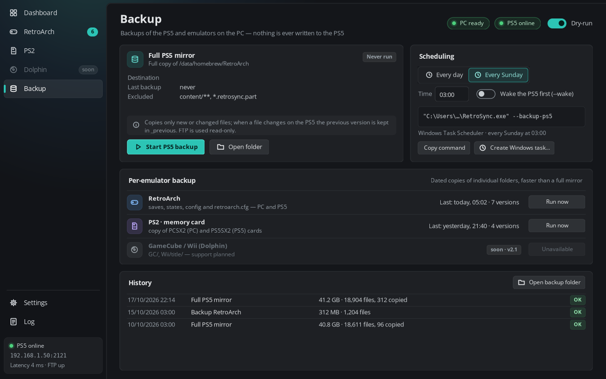
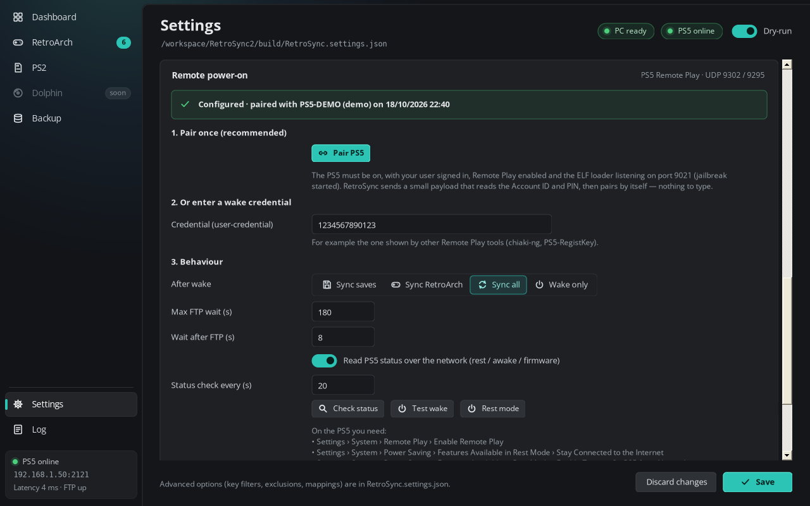

# RetroSync

Sync RetroArch saves and config between a Windows PC (Steam RetroArch) and a jailbroken PS5 running RetroArch homebrew. Also syncs PS2 memory cards, mirrors PS5 folders for backup, and can wake the console from rest mode (and put it back) over the network.



## Features

- **RetroArch sync** — saves, states, config, cores, shaders and playlists between Steam RetroArch on Windows and RetroArch on the PS5 (FTP). Preview before apply; dry-run mode; per-file actions (PC→PS5, PS5→PC, merge, skip).
- **PS2 memory cards** — compare and move saves with `mymc`, with backups before writing.
- **PS5 backup mirror** — one-way PS5→PC folder mirror and dated per-emulator folder backups. Optional Task Scheduler command.
- **Remote power-on** — wake from rest mode via Sony’s discovery protocol (UDP 9302). One-time **automatic pairing**: RetroSync sends a small helper ELF to the jailbreak ELF loader (port 9021); the helper reads the signed-in user’s account ID (read-only) and a Remote Play PIN, returns them over TCP 9303 with a one-time token, then exits. RetroSync registers on TCP 9295 and stores the wake credential. You can also paste an existing credential.
- **Rest mode** — *Rest mode* button sends a one-shot helper that calls the system standby API only (no reboot / shutdown). Confirmation dialog first.
- **Language** — English by default (new installs). Italian available under *Settings → Advanced → Language / Lingua* (restart recommended after changing).


## Download

Latest release: [https://github.com/aleksejsgx/RetroSync/releases/latest](https://github.com/aleksejsgx/RetroSync/releases/latest)

| Package | File | Notes |
|---|---|---|
| **Windows portable** | `RetroSync-*-win-x64-portable.zip` (or `.exe`) | Settings next to the exe. Drop the folder anywhere. |
| **Windows installer** | `RetroSync-*-win-x64-setup.exe` | Per-user install (`%LOCALAPPDATA%\Programs\RetroSync`), Start menu, uninstaller. Settings in `%APPDATA%\RetroSync`. |
| **Linux experimental** | `RetroSync-*-linux-x64-experimental.tar.gz` | Runs under Mono (`retrosync.sh`). Untested on real desktops — see `README-LINUX.md` in the archive. |

Checksums are in `SHA256SUMS.txt` on the release page.

## Tested with

- **RetroArch:** Steam RetroArch on Windows ↔ RetroArch homebrew port on PS5.
- **PS2:** PCSX2 on Windows ↔ [PS5SX2](https://github.com/Swordpdf/PS5SX2) on PS5.
- **Coming next:** Dolphin on Windows ↔ [Porpoise](https://github.com/elripalda/Porpoise-Dolphin-Emulator-for-PS5) (Dolphin port for PS5) for GameCube/Wii saves.

Other emulators or ports have not been tested and are not supported for now.

## Screenshots

| Dashboard | RetroArch | PS2 | Backup | Remote power-on |
|---|---|---|---|---|
|  |  |  |  |  |

## Requirements

- Windows 10/11 with .NET Framework 4.8 (included with Windows).
- Jailbroken PS5 with an FTP payload (default port 2121) and RetroArch homebrew; PC and PS5 on the same LAN.
- Steam RetroArch on the PC (other installs work if you set the folder).
- For PS2 cards: PCSX2 on the PC, [PS5SX2](https://github.com/Swordpdf/PS5SX2) on the PS5, and `mymc.exe`.
- For pairing / rest mode: ELF loader listening on port **9021**, user signed in, Remote Play enabled. For wake from rest: *Stay Connected to the Internet* and *Enable Turning On PS5 from Network*.

## Install

**Portable:** unzip the portable package (or copy the `.exe`) into its own folder and run `RetroSync.exe`. Settings live next to the exe (`RetroSync.settings.json`). To update, replace only the exe.

**Installer:** run `RetroSync-*-win-x64-setup.exe` (per-user, no admin). Shortcuts go to the Start menu; settings are stored in `%APPDATA%\RetroSync`.

Then open **Settings**, set the PS5 IP, RetroArch folders and backup folder, and use **Sync all** with dry-run on to inspect the preview.

### First-time remote power-on

1. On the PS5: enable Remote Play; enable network features in rest mode; start the jailbreak ELF loader on 9021; sign in.
2. In RetroSync → **Settings → Remote power-on** → **Pair PS5**.
3. Put the PS5 in rest mode, then try **Test wake** or **Wake PS5** on the Dashboard.

## Command line

```
RetroSync.exe --dry-run [--saves | --config | --all] [--no-ps2] [--log <file>]
RetroSync.exe --backup-ps5 [--move-deleted] [--log <file>]
RetroSync.exe --baseline [--saves | --config | --all]
RetroSync.exe --wake [--backup-ps5 | --dry-run ...]
RetroSync.exe --demo [--page dashboard|retroarch|ps2|backup|settings|wake|log]
```

## Build

Windows (no Visual Studio required):

```
cd src
build.bat
```

Uses the .NET Framework C# compiler. Embeds `retrosync-pair.elf` and `retrosync-rest.elf`.

Linux/macOS with Mono:

```
cd src
mcs -langversion:5 -target:winexe -sdk:4.5 -win32icon:app.ico -out:RetroSync.exe \
    -r:System.Windows.Forms.dll -r:System.Drawing.dll -r:System.Core.dll -r:System.Web.Extensions.dll \
    -resource:retrosync-pair.elf,retrosync-pair.elf -resource:retrosync-rest.elf,retrosync-rest.elf *.cs
```

Rebuild the helpers (optional) with the [PS5 payload SDK](https://github.com/ps5-payload-dev/sdk):

```
cd payload
make PS5_PAYLOAD_SDK=/opt/ps5-payload-sdk
cp retrosync-*.elf ../src/
```

Offline tests: `tests/run_tests.sh` (Mono, Node, a C compiler, Python 3; clone [playactor](https://github.com/dhleong/playactor) for reference keys).

## Credits

- [playactor](https://github.com/dhleong/playactor) by Daniel Leong (**ISC**) — Remote Play registration algorithm; PS5 key tables included as data. See THIRD_PARTY_NOTICES.
- [ps5-payload-dev/sdk](https://github.com/ps5-payload-dev/sdk) (**GPL-3.0-or-later** toolchain) — used to build the pairing and rest helpers. FreeBSD headers in the SDK are BSD-licensed; the CRT/runtime linked into the ELFs is GPL-3+. Helper **source** in `payload/` is MIT; redistributed **ELF binaries** are GPL-3+ combined works. Corresponding Source: `payload/*.c` in this repo plus the SDK.
- [PS5Upload](https://github.com/phantomptr/ps5upload) (GPL-3.0) — behaviour reference only (wake flow, rest mode API name, console checklist). No code copied.
- [ps5-wake](https://github.com/iharosi/ps5-wake) / [chiaki-ng](https://github.com/streetpea/chiaki-ng) — protocol behaviour reference only.

RetroSync is not affiliated with Sony Interactive Entertainment or with RetroArch / PCSX2 / PS5SX2 / Dolphin / Porpoise. “PlayStation” and “PS5” are trademarks of Sony Interactive Entertainment.

## Licence

MIT (application). The optional pairing / rest-mode helper ELFs link the [ps5-payload-dev SDK](https://github.com/ps5-payload-dev/sdk) CRT and are therefore **GPL-3.0-or-later as binaries**; their own C source under `payload/` is MIT. See [THIRD_PARTY_NOTICES.txt](THIRD_PARTY_NOTICES.txt).
